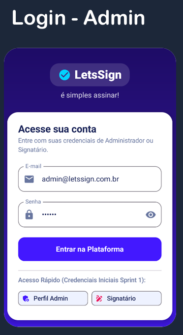
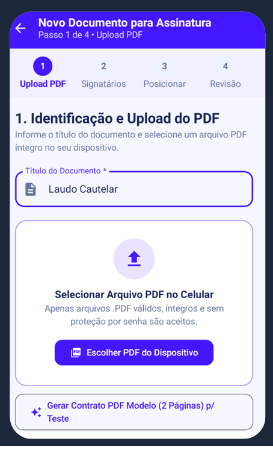
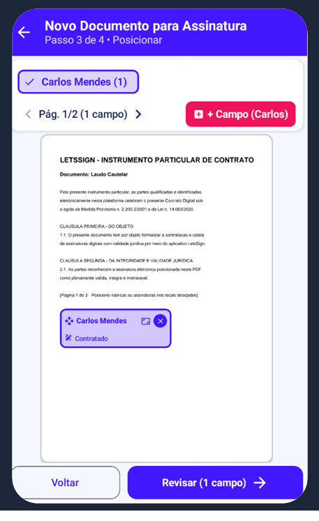
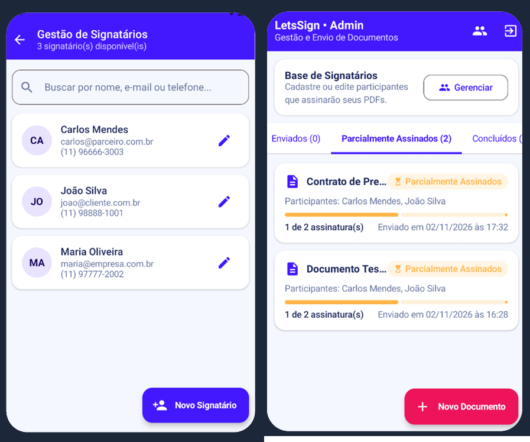
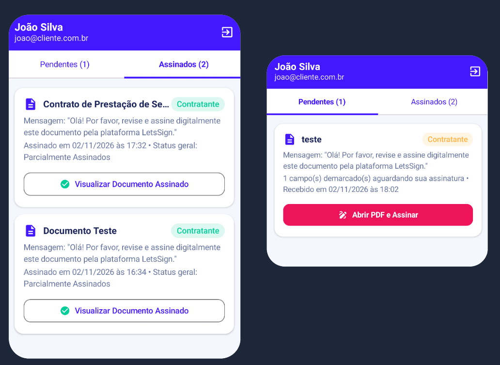

# 📱 LetsSign Mobile - Plataforma de Assinatura Digital (FIAP MVP)

**Visão Executiva:** O LetsSign Mobile é um MVP (Minimum Viable Product) de um aplicativo 100% nativo desenvolvido para otimizar o ciclo de vida de assinaturas eletrônicas. O projeto converte processos burocráticos em uma jornada ágil diretamente na palma da mão, garantindo fluidez e validade jurídica.

🎥 **[Assista ao Vídeo Demonstrativo do Aplicativo em funcionamento aqui](https://www.youtube.com/watch?v=B1qP2JngOSU)**

## 🎯 A Dor do Negócio (O Paradoxo Mobile)
Embora os ecossistemas de assinatura eletrônica sejam robustos na web, a experiência em dispositivos móveis frequentemente falha. A tentativa de posicionar assinaturas, validar documentos e recolher rubricas através de navegadores mobile gera fricção.
*   **O Risco para a Empresa:** Documentos travados, perda de validade por erros de preenchimento e atrasos no fechamento de negócios devido a uma interface não responsiva.
*   **O Desafio:** Criar uma ferramenta que reduza o atrito do signatário e dê controle total ao gestor em trânsito.

## 💡 A Solução e Proposta de Valor
Desenvolvemos uma aplicação móvel focada na usabilidade *frictionless* (sem atrito), precisão visual e segurança operacional. A plataforma foi dividida em duas jornadas distintas:

### ⚙️ Jornada do Administrador (Gestão e Envio)
*   **Gestão Completa:** Upload de PDFs íntegros, cadastro de signatários e acompanhamento de status (Enviados, Parcialmente Assinados, Concluídos) em tempo real.
*   **Motor Visual (Drag & Drop):** Posicionamento interativo dos campos de assinatura diretamente no documento renderizado, utilizando coordenadas relativas para garantir precisão geométrica independentemente da tela do dispositivo.
*   **Prevenção de Erros:** Validação binária do PDF e regras de negócio rígidas (imutabilidade após o disparo).

### ✍️ Jornada do Signatário (Foco Direcionado)
*   **Acesso Simplificado:** Visualização clara de documentos pendentes.
*   **Foco Direcionado:** O PDF é aberto já ancorado na coordenada exata exigida para a ação.
*   **Assinatura Manuscrita:** Quadro interativo para captura de rubrica com estampa matemática definitiva no documento.

## 📸 Interface e Experiência do Usuário (UX)
A interface foi construída para garantir uma curva de aprendizado nula e máximo engajamento.

  
  
  

 

  
  

## 🏗️ Arquitetura e Engenharia de Software (Bastidores)
A aplicação não é apenas uma interface; ela foi concebida sob rigorosos padrões de engenharia para permitir escalabilidade corporativa:
*   **Arquitetura:** Clean Architecture com padrão MVVM (Model-View-ViewModel), garantindo o total desacoplamento entre a interface e as regras de negócio.
*   **Linguagem & UI:** Kotlin + Jetpack Compose (Interfaces declarativas e reativas).
*   **Persistência de Dados (Sprint 1):** Room Database (SQLite) com transações atômicas para assegurar a consistência e imutabilidade dos registros.
*   **Processamento de Documentos:** Implementação do motor *PDFBox-Android* e *PdfRenderer* para manipulação binária do documento e estampa da assinatura manuscrita.

*(O código-fonte estruturado está preservado no diretório base deste repositório para auditoria técnica).*
